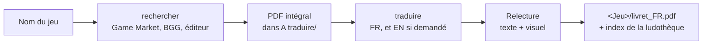

# regles-jeu

[](https://code.claude.com/docs/fr/plugins)
[](CHANGELOG.md)
[](#)

**Plugin Claude Code pour jouer en français (ou en anglais) à des jeux de société venus d'ailleurs.**
Donnez le nom d'un jeu : Claude trouve son livret de règles sur internet, l'enregistre en PDF, puis le traduit
**en gardant exactement la mise en page** (polices, illustrations, icônes, encadrés).

> « Trouve-moi les règles de Hyakuju Parade » → livret anglais officiel téléchargé →
> « Oui, traduis-le » → `HYAKUJU_PARADE_English_Rulebook_FR.pdf`, prêt à imprimer.

Spécialisé dans les jeux japonais du **Tokyo Game Market**, il fonctionne pour n'importe quel jeu.

---

## Sommaire
- [Fonctionnalités](#fonctionnalités)
- [Démarrage rapide](#démarrage-rapide)
- [Prérequis](#prérequis)
- [Installation](#installation)
- [Utilisation](#utilisation)
- [Contenu du plugin](#contenu-du-plugin)
- [Organisation des dossiers](#organisation-des-dossiers)
- [Coût en jetons](#coût-en-jetons)
- [Mise à jour et désinstallation](#mise-à-jour-et-désinstallation)
- [Dépannage](#dépannage)
- [Limites connues](#limites-connues)
- [Développement](#développement)
- [Crédits](#crédits)

---

## Fonctionnalités



**Recherche** ([`rechercher`](skills/rechercher/README.md))
- Trouve le livret à partir du seul nom (titre anglais, romanisé ou japonais) : Tokyo Game Market, BoardGameGeek,
  site ou Google Drive de l'éditeur, blog de l'auteur.
- Propose en premier la version anglaise officielle d'un jeu japonais, et garde toujours le lien du manuel d'origine.
- Met en PDF, sans rien couper, des règles publiées sur une page web ou Notion.
- Accepte une liste de jeux : une seule série de questions, un seul bilan.

**Traduction** ([`traduire`](skills/traduire/README.md))
- Depuis n'importe quelle langue (anglais, japonais, allemand…), vers le français, et l'anglais si demandé
  (un seul passage pour les deux langues).
- Conserve la mise en page : polices de remplacement choisies et mesurées, accents complets, icônes dans le texte.
- Gère les livrets **scannés** : lecture automatique, puis texte traduit posé sur le scan, ou livret recomposé à neuf
  pour un scan froissé.
- Signale un livret d'au moins **10 Mo** (limite Discord) et propose alors une **version allégée**, le livret en
  pleine qualité restant intact.
- Produit à la demande une **version économe en encre** d'un livret à fond sombre : même mise en page, fond blanc,
  texte foncé, illustrations intactes — livrée à côté du livret normal, qui reste la référence.
- Contrôles automatiques (débordements, texte oublié, orthographe) et relecture par deux agents dédiés.
- Range le résultat à côté de l'original et tient à jour l'index de la ludothèque.

Testé sur plus de vingt livrets, dont Trick Jack, Hit and Win, Monochrome Overtime, Kajitsu Tobu, CMYK,
The Good Farmer, Poker Avoces, Shinobi Blade et Man Eating House.

---

## Démarrage rapide
```
/plugin marketplace add vinchy1/regles-jeu
/plugin install regles-jeu@regles-jeu
pip install pymupdf fonttools lxml pyspellchecker
```
Créez un dossier `A traduire` dans votre ludothèque, ouvrez Claude Code dans la ludothèque et demandez :
« trouve-moi les règles de Cat in the Box ».

---

## Prérequis
| Élément | Nécessaire pour | Obligatoire |
|---|---|---|
| [Claude Code](https://code.claude.com) avec la gestion des plugins | tout | oui |
| Python 3 + `pymupdf`, `fonttools`, `lxml` | lire et écrire les PDF, polices, pages web | oui |
| `pyspellchecker` | contrôle d'orthographe de la relecture | non |
| Google Chrome ou Microsoft Edge | mise en PDF des pages web (profil temporaire, votre navigateur n'est pas touché) | pour les règles en ligne |
| Extension **Claude in Chrome** | lire BoardGameGeek, télécharger un fichier qui demande d'être connecté | conseillé |
| Windows + module de lecture de la langue (OCR) | lecture automatique des livrets scannés | non (sinon lecture en images, plus coûteuse) |

Détails, dont l'installation du module de lecture du japonais : [prérequis de traduire](skills/traduire/README.md#installation).

---

## Installation

### Depuis la boutique (recommandé)
Dans Claude Code :
```
/plugin marketplace add vinchy1/regles-jeu
/plugin install regles-jeu@regles-jeu
```
En ligne de commande : `claude plugin marketplace add vinchy1/regles-jeu`, puis
`claude plugin install regles-jeu@regles-jeu`. Vérifier avec `/plugin` (onglet « Installés ») ou
`claude plugin details regles-jeu`.

### Pour un groupe de joueurs
Pour que Claude Code propose le plugin à tous ceux qui ouvrent une même ludothèque partagée, ajoutez à son
`.claude/settings.json` :
```json
{
  "extraKnownMarketplaces": {
    "regles-jeu": { "source": { "source": "github", "repo": "vinchy1/regles-jeu" } }
  },
  "enabledPlugins": { "regles-jeu@regles-jeu": true }
}
```
Chacun doit d'abord accorder sa confiance au dossier quand Claude Code le lui demande.

### Pour modifier le plugin
Cloner le dépôt dans le dossier des skills : Claude Code le charge directement, sans copie, et chaque modification
est prise en compte à la session suivante (ou avec `/reload-plugins`).
```
git clone https://github.com/vinchy1/regles-jeu.git ~/.claude/skills/regles-jeu
```
N'installez pas en plus la version de la boutique : les skills apparaîtraient en double.

### Configuration de la ludothèque
Facultatif : un `CLAUDE.md` à la racine de la ludothèque peut noter le chemin de Python ou un autre nom de
dossier de dépôt. Les chemins propres à votre machine vont là, jamais dans le plugin.

---

## Utilisation
Les skills se déclenchent seules d'après votre demande ; les commandes directes servent à les forcer.

| Vous dites | Ce qui se passe |
|---|---|
| « Trouve-moi les règles de Hyakuju Parade » | recherche, choix de la version, téléchargement, proposition de traduire |
| `/regles-jeu:rechercher Bird Club, Break The Heart` | plusieurs jeux d'un coup, un seul bilan |
| « Traduis-moi ce livret : MonJeu_rules.pdf » | traduction en français, relecture, rangement |
| « Traduis-le en français et en anglais » | les deux versions, `_FR.pdf` et `_EN.pdf` |
| « Dans Merge Take, remplace "la plus forte" par "de plus haute valeur" » | correction d'une traduction déjà livrée |
| « Ce livret est tout noir, je vais l'imprimer » | version économe en encre, en plus du livret normal |
| « Il est trop lourd pour Discord » | version allégée sous 10 Mo, le livret d'origine étant conservé |

Exemple réel :
> **Vous** : /regles-jeu:rechercher Hyakuju Parade
> **Claude** : J'ai trouvé deux versions officielles (fiche Game Market, Bamboo Games) : anglais et japonais.
> Laquelle voulez-vous ?
> **Vous** : Anglais
> **Claude** : Livret enregistré : `A traduire\HYAKUJU_PARADE_English_Rulebook.pdf` (2 pages, copie exacte du
> fichier de l'éditeur). Liens gardés dans `_outils\Hyakuju Parade\NOTES.md`. Voulez-vous que je le traduise ?

Guides complets : [rechercher](skills/rechercher/README.md#utilisation) ·
[traduire](skills/traduire/README.md#utilisation).

---

## Contenu du plugin
| Composant | Type | Rôle | Modèle |
|---|---|---|---|
| `rechercher` | skill | trouve et télécharge le livret | celui de la session |
| `traduire` | skill | traduit et met en page | celui de la session |
| `regles-jeu:relecteur-texte` | agent | relit la traduction (contresens, oublis, vocabulaire, fautes) | Sonnet |
| `regles-jeu:relecteur-visuel` | agent | compare chaque page à l'original | Sonnet |

```
.claude-plugin/   plugin.json (manifeste) et marketplace.json (boutique)
agents/           les deux relecteurs
skills/
├── rechercher/   SKILL.md, references/ (cas particuliers), scripts/ (Game Market, téléchargement, pages web)
└── traduire/     SKILL.md, references/, scripts/ (préparation, construction, contrôles, livraison), exemples/
CHANGELOG.md      historique des versions
```

---

## Organisation des dossiers
```
<Ludothèque>/
├── A traduire/          PDF déposés, en attente de traduction
├── <Jeu>/               livrets seulement : original, _FR.pdf, _EN.pdf
└── _outils/
    ├── LISEZMOI.md      index des jeux traduits (une ligne par jeu)
    └── <Jeu>/           outils du jeu (spec, polices, NOTES.md avec les liens et les choix)
```
Le dossier d'outils de chaque jeu est conservé pour pouvoir corriger une traduction plus tard.

---

## Coût en jetons
| Moment | Coût approximatif |
|---|---|
| Plugin installé, inutilisé | ~650 jetons par session (descriptions des skills et des agents) |
| Recherche d'un jeu | quelques dizaines de milliers de jetons |
| Traduction d'un livret de quelques pages | 150 000 à 200 000 jetons ; davantage pour un scan ou un long livret |

Les scripts font le travail mécanique, les images ne sont regardées qu'à bon escient et les relectures tournent
sur Sonnet dans des agents séparés. Pour changer leur modèle : ligne `model:` des fichiers de `agents/`.
Détail : [coût en jetons et modèles](skills/traduire/README.md#coût-en-jetons-et-modèles).

---

## Mise à jour et désinstallation
| Installation | Mettre à jour | Désinstaller |
|---|---|---|
| Boutique | `/plugin marketplace update regles-jeu` puis `/plugin update regles-jeu@regles-jeu` | `/plugin uninstall regles-jeu@regles-jeu` |
| Clone | `git -C ~/.claude/skills/regles-jeu pull --ff-only` | supprimer le dossier `~/.claude/skills/regles-jeu` |

Dans une session déjà ouverte, `/reload-plugins` prend en compte la nouvelle version. Vos livrets, l'index et les
dossiers d'outils de la ludothèque ne sont jamais touchés par une mise à jour ou une désinstallation.
Les changements de chaque version sont dans le [CHANGELOG](CHANGELOG.md).

---

## Dépannage
| Problème | Solution |
|---|---|
| Les skills apparaissent en double | le plugin est à la fois cloné et installé depuis la boutique : `claude plugin disable regles-jeu@regles-jeu` (ou supprimer le clone) |
| Les relecteurs ne sont pas trouvés | ouvrir une nouvelle session ou taper `/reload-plugins` ; vérifier `claude plugin details regles-jeu` |
| `ModuleNotFoundError: pymupdf` (ou `fontTools`, `lxml`) | relancer `pip install pymupdf fonttools lxml` avec le Python utilisé par Claude (noter son chemin dans le `CLAUDE.md` de la ludothèque) |
| BoardGameGeek refuse la lecture | installer l'extension Claude in Chrome |
| La version allégée reste au-dessus de 10 Mo | livret presque entièrement fait de grandes images : l'envoyer en deux fichiers (deux moitiés de pages) |
| La version économe en encre garde des zones sombres | lire le journal : fond posé avec une matrice tournée (« À VÉRIFIER ») ou couleurs en ton direct, laissées intactes ; un livret scanné n'est pas couvert |
| Scan japonais non lu automatiquement | installer le module de lecture du japonais : [prérequis de traduire](skills/traduire/README.md#installation) |
| Anciennes skills `recherche-regles-jeu` / `traduction-regles-jeu` encore présentes | les supprimer de `~/.claude/skills/` : le plugin les remplace |

---

## Limites connues
- Texte vertical japonais et texte dessiné dans les illustrations : signalés, parfois laissés tels quels.
- Le français prend 1,5 à 2 fois plus de place que le japonais : traduction plus concise, police réduite, signalées.
- Fichiers Google Drive en lecture seule : récupérés seulement en images, avec votre accord.
- Testé sous Windows ; la lecture automatique des scans est propre à Windows.
- Version économe en encre : pour les livrets à texte et les livrets recomposés, pas pour les scans (le fond y est
  l'image scannée elle-même).

Listes complètes : [rechercher](skills/rechercher/README.md#limites-connues) ·
[traduire](skills/traduire/README.md#limites-connues).

---

## Développement
- **Vérifier le plugin** : `claude plugin validate .` (manifeste et boutique) et `claude plugin details regles-jeu`
  (composants, coût).
- **Non-régression** : après une modification des moteurs, reconstruire quelques livrets déjà livrés et les
  comparer aux originaux (texte mot pour mot, ou pixels pour les scans).
- **Versions** : numérotation sémantique dans `.claude-plugin/plugin.json` (correctif `1.0.x`, nouveauté `1.x.0`,
  changement de fonctionnement `x.0.0`), notée dans le [CHANGELOG](CHANGELOG.md). Les utilisateurs de la boutique
  ne reçoivent une mise à jour que si la version change.
- **Contributions** : par demande de fusion sur ce dépôt ; décrire le livret qui a servi de test.

---

## Crédits
- Plugin maintenu par [vinchy1](https://github.com/vinchy1).
- Skill de traduction initiée par [notoriousFabb](https://github.com/notoriousFabb/traduction-regles-jeu) ; ce
  dépôt évolue de façon indépendante, et ses nouveautés ne sont reprises qu'à la demande
  (`git fetch notoriousfabb`, puis `git merge -X subtree=skills/traduire notoriousfabb/main`).
- Réunit, avec tout leur historique, les anciens dépôts
  [recherche-regles-jeu](https://github.com/vinchy1/recherche-regles-jeu) et
  [traduction-regles-jeu](https://github.com/vinchy1/traduction-regles-jeu) (archivés).

**Usage personnel** : ne diffusez les livrets traduits qu'avec l'accord de l'éditeur du jeu.
